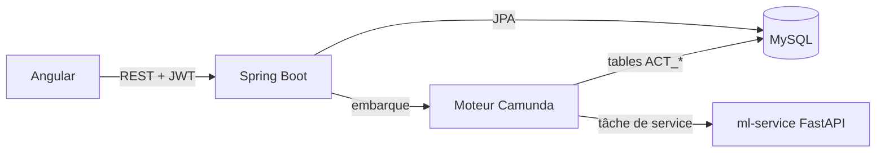
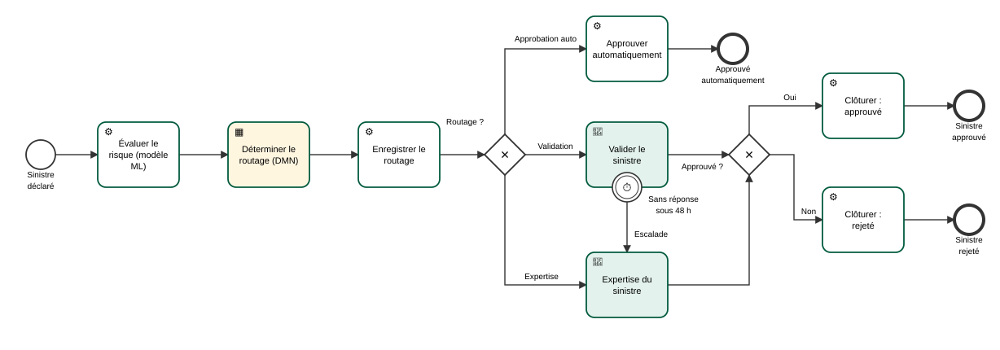

# Assurance-Project

Plateforme de gestion d'assurance automobile : tarification des contrats, déclaration des sinistres,
**évaluation du risque des sinistres par un modèle de machine learning** et **workflow d'approbation
orchestré par Camunda** qui exploite les prédictions du modèle.

| Couche | Technologies |
|---|---|
| Frontend | Angular 11, Angular Material |
| Backend | Spring Boot 2.6 (Java 11), Spring Data JPA, Spring Security + JWT, MySQL |
| Workflow | Camunda Platform 7.17 embarqué (BPMN 2.0 + DMN 1.3, Cockpit et Tasklist) |
| Machine learning | Python, scikit-learn, FastAPI (`ml-service/`) |

## Fonctionnalités

- **Tarification** des primes selon la puissance fiscale, la classe bonus-malus et le type de véhicule
  (tourisme, commercial, taxi).
- **Gestion** des agences, agents, clients et véhicules, avec authentification et rôles (`User`, `Admin`).
- **Déclaration des sinistres** par les agents.
- **Scoring du risque** de chaque sinistre par un modèle ML (probabilité calibrée et niveau
  FAIBLE / MOYEN / ÉLEVÉ).
- **Workflow d'approbation des sinistres** (Camunda) : le score ML et le montant passent par une table de
  décision DMN, qui choisit entre l'approbation automatique, la validation par un agent ou l'expertise. Un
  dossier en validation sans réponse au bout de 48 h est escaladé vers l'expertise.

## Architecture



## Workflow d'approbation (`Backend/src/main/resources/processes/`)



1. **Évaluer le risque (modèle ML)** : `EvaluationRisqueDelegate` appelle `POST /predict` du service ML.
   Si le service ne répond pas, le niveau passe à `INDISPONIBLE` et le dossier part en validation manuelle :
   aucun sinistre n'est bloqué par une panne du modèle.
2. **Déterminer le routage (DMN)** : la table `decision-routage-sinistre.dmn` (politique de résultat UNIQUE) :

   | Niveau de risque | Montant déclaré (DT) | Routage |
   |---|---|---|
   | INDISPONIBLE | – | VALIDATION_AGENT |
   | ELEVE | – | EXPERTISE |
   | MOYEN | ≤ 20 000 | VALIDATION_AGENT |
   | MOYEN | > 20 000 | EXPERTISE |
   | FAIBLE | ≤ 3 000 | AUTO_APPROBATION |
   | FAIBLE | 3 000 – 20 000 | VALIDATION_AGENT |
   | FAIBLE | > 20 000 | EXPERTISE |

3. **Tâches humaines** : « Valider le sinistre » (groupe `User`) et « Expertise du sinistre » (groupe
   `Admin`). Les groupes Camunda correspondent aux rôles de l'application.
4. **Clôture** : statut `APPROUVE` (avec le montant indemnisé, plafonné au montant déclaré) ou `REJETE`
   (le motif est obligatoire).

Les seuils se modifient dans le DMN sans toucher au code Java. Cockpit et Tasklist sont disponibles sur
http://localhost:8090/camunda (identifiants `CAMUNDA_ADMIN_USER` / `CAMUNDA_ADMIN_PASSWORD`, `demo`/`demo` par
défaut).

## Modèle de risque (`ml-service/`)

- **Cible** : `sinistre_a_risque`, un sinistre suspect ou atypique qui justifie une expertise.
- **Variables** : type de véhicule et de sinistre, puissance, valeur du véhicule, classe bonus-malus, montant
  déclaré et ratio montant/valeur, délai de déclaration, sinistres antérieurs du véhicule, accident de nuit,
  témoins, constat amiable. Elles viennent toutes des entités `Voiture`, `Client` et `Sinistre`.
- **Sélection** : régression logistique et gradient boosting comparés par validation croisée stratifiée en
  5 plis (AUC-ROC). Le meilleur modèle est ensuite calibré (isotonique).
- **Résultats sur le jeu de test** (4 000 sinistres, 11 % positifs) : AUC-ROC 0,856, précision moyenne 0,51,
  Brier 0,072. Taux réel de sinistres à risque par niveau prédit : FAIBLE 5 %, MOYEN 39 %, ÉLEVÉ 67 %.
  Détail dans `ml-service/models/metrics.json`.

> **Données** : le projet ne dispose pas d'historique réel de sinistres. `generate_data.py` produit
> 20 000 sinistres **synthétiques**, avec des règles métier bruitées (déclaration tardive, montant élevé
> par rapport à la valeur du véhicule, historique chargé, etc.). Les métriques ci-dessus portent donc
> uniquement sur ces données. Pour entraîner le modèle sur des données réelles, il suffit d'un CSV avec les
> mêmes colonnes : `python train.py --data mon_fichier.csv`.

## API ajoutée

| Méthode | Route | Rôle | Description |
|---|---|---|---|
| POST | `/sinistre` | User | Déclare un sinistre et démarre le workflow |
| GET | `/sinistre`, `/sinistre/{id}` | User, Admin | Liste ou détail des sinistres |
| GET | `/sinistre/taches` | User, Admin | Tâches Camunda en attente pour les groupes de l'utilisateur |
| POST | `/sinistre/taches/{taskId}/decision` | User, Admin | `{ "approuve": true, "montantIndemnise": 4000, "commentaire": "…" }` |

Service ML : `POST /predict`, `GET /health`, `GET /model-info` (documentation interactive sur
http://localhost:8000/docs).

## Lancer le projet

### Avec Docker (MySQL, service ML, backend)

```bash
docker compose up --build
cd Frontend && npm install && npm start     # http://localhost:4200
```

### Sans Docker

```bash
# 1. Service ML
cd ml-service
pip install -r requirements.txt
python generate_data.py && python train.py
uvicorn app.main:app --port 8000

# 2. Backend (MySQL sur localhost:3306, base STAR créée automatiquement)
cd Backend && ./mvnw spring-boot:run

# 3. Frontend
cd Frontend && npm install && npm start
```

Angular 11 attend Node 14. Avec une version plus récente de Node, préfixer les commandes par
`NODE_OPTIONS=--openssl-legacy-provider`.

Variables d'environnement du backend : `DB_URL`, `DB_USER`, `DB_PASSWORD`, `ML_SERVICE_URL`,
`CAMUNDA_ADMIN_USER`, `CAMUNDA_ADMIN_PASSWORD`.

## Tests

```bash
cd ml-service && pip install -r requirements-dev.txt && pytest       # API et cohérence du modèle
cd Backend && ./mvnw verify                                           # workflow Camunda sur H2, ML simulé
```

`ApprobationSinistreWorkflowTest` couvre les quatre circuits : approbation automatique, validation par un
agent, expertise suivie d'un rejet, et service ML indisponible. Il teste aussi l'escalade par timer et le
contrôle du montant indemnisé.

## Limites et pistes

- Les données d'entraînement sont synthétiques (voir plus haut).
- Camunda 7 Community n'est plus maintenu depuis octobre 2025. La migration naturelle se fait vers
  Camunda 8 ou vers Operaton, le fork communautaire de Camunda 7 compatible au niveau de l'API.
